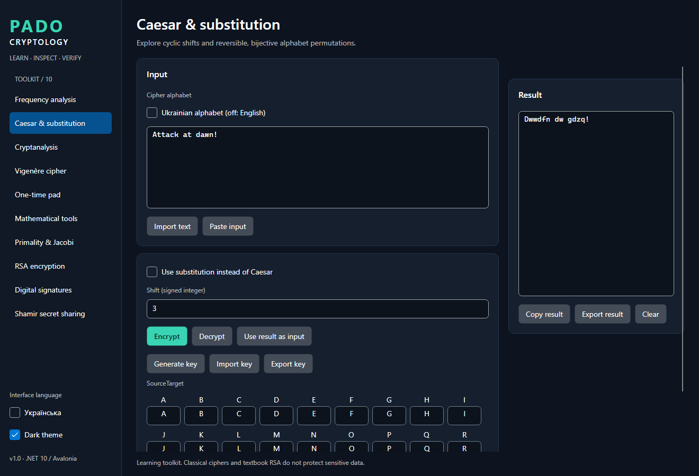

# PADO Cryptology

**Cryptography & Cryptanalysis Toolkit · C# / .NET 10 · Avalonia UI**

[](https://github.com/PADOALEX/PADO-Cryptology/actions/workflows/ci.yml)

## Project Overview

PADO Cryptology is a desktop learning toolkit for classical ciphers, text analysis, number theory, RSA demonstrations and secret sharing. It migrates the author's original CustomTkinter application into a modular C# solution while preserving its ten learning workflows and Ukrainian/English alphabets.

The original thirteen Python source files are retained in [`legacy/python`](legacy/python). The [source audit and migration map](docs/audit/README.md) identify correct behavior, deliberate corrections and reproducible Python control vectors. This project is educational software with separate demonstrations of standard cryptographic APIs; it is not a production data-protection product.

## Features

- Ten modules in a sidebar desktop interface, dark/light themes, Ukrainian/English UI, and cipher alphabet selection independent of UI language.
- Unicode-aware frequency counts, explicit inclusion options, percentages, CSV export and a chart comparing text with a reference profile.
- Caesar, monoalphabetic substitution and Vigenère, with case/punctuation preservation, validated keys and Ukrainian Ґ, Є, І, Ї support.
- Manual cryptanalysis tables, duplicate highlighting, live highlighted preview, overlapping bigrams/trigrams, coverage statistics, JSON mapping exchange, baseline frequency guesses and transparent Caesar chi-square ranking.
- Byte-level UTF-8 XOR with cryptographic random pads, strict byte lengths and Base64/HEX interchange.
- Arbitrary-precision arithmetic, bounded mathematical traces, probable-prime tests, cancellable prime generation and strict integer RSA examples.
- Separate platform RSA-OAEP SHA-256 and streaming RSA-PSS SHA-256 file signatures, public PEM exchange and explicit encrypted private-key export.
- Prime-field Shamir sharing with threshold metadata, JSON interchange, parameter validation and Lagrange recovery.
- Clipboard/text-file operations, asynchronous commands, progress state, cancellation and automated unit/integration/headless UI checks.

## Technology Stack

| Area | Implementation |
|---|---|
| Runtime and language | .NET 10, C# 14, nullable reference types |
| Desktop | Avalonia 11.3, Fluent themes, CommunityToolkit.Mvvm |
| Composition | Microsoft.Extensions.DependencyInjection |
| Mathematics | System.Numerics.BigInteger; project-owned arithmetic algorithms |
| Standard cryptography | System.Security.Cryptography.RSA, SHA-256, RandomNumberGenerator |
| Tests | xUnit, Microsoft.NET.Test.Sdk, Avalonia.Headless.XUnit |
| Automation | GitHub Actions Windows/Ubuntu Release restore/build/test matrix |

## Architecture

`Cryptology.Core` contains GUI-independent algorithms and immutable alphabet/key models. `Cryptology.Security` delegates modern primitives to the platform provider. Desktop view models orchestrate those libraries through asynchronous commands; file dialogs and clipboard access remain in Desktop services. The CLI invokes the same libraries.

See the [dependency diagram and design notes](docs/architecture/overview.md). No web server, database or account system is required.

## Supported Algorithms

| Area | Algorithms and operations |
|---|---|
| Classical ciphers | Caesar, monoalphabetic substitution, [Vigenère](docs/algorithms/vigenere.md) |
| Cryptanalysis | Frequencies, overlapping n-grams, manual substitution, baseline rank matching, Caesar chi-square ranking |
| Integer arithmetic | GCD, [extended Euclid](docs/algorithms/extended-euclid.md), modular inverse, square-and-multiply, random/coprime integers |
| Primality | [Jacobi symbol, Solovay–Strassen, Miller–Rabin](docs/algorithms/jacobi.md), probable-prime generation |
| RSA | [Educational integer RSA and raw hash signatures](docs/algorithms/rsa.md); platform OAEP/PSS with SHA-256 |
| Byte XOR | UTF-8 bytes, exact-length random pad, Base64 ciphertext and Base64/HEX keys |
| Secret sharing | [Shamir polynomial splitting and Lagrange interpolation](docs/algorithms/shamir.md) in a validated prime field |

## Educational vs Secure Modes

| Mode | Purpose and boundary |
|---|---|
| Historical ciphers | Explain transformations and attacks; unsuitable for confidential information. |
| Educational RSA/signatures | Show p,q,n,phi,e,d and modular powers. Unpadded textbook arithmetic is insecure. |
| Byte XOR / OTP demonstration | Teach reversible byte operations and one-use-pad rules. Ciphertexts are unauthenticated; the app cannot enforce secrecy or non-reuse. |
| Shamir demonstration | Teach finite-field polynomials and thresholds. Shares and metadata are unauthenticated. |
| Standard API demos | Use the platform RSA provider for OAEP/PSS rather than custom padding. This boundary does not establish security of the whole application. |

The [security document](docs/security.md) explains randomness, key lifetime, private export, tampering, memory limitations and exact cryptographic boundaries.

## Installation

Install the [.NET 10 SDK](https://dotnet.microsoft.com/download/dotnet/10.0) and Git, then clone the repository:

```sh
git clone https://github.com/PADOALEX/PADO-Cryptology.git
cd PADO-Cryptology
dotnet --info
dotnet restore PADO.Cryptology.sln
```

`global.json` selects SDK 10.0.102 with patch roll-forward within that feature band. Install a compatible 10.0.1xx SDK if your machine only has another feature band. Python and CustomTkinter are not needed to run the C# application; Python is only used to regenerate historical control vectors.

The development and validation environment is Windows. See [actual validation results](docs/validation.md) for the current native-launch and test record. Ubuntu CI is configured; a workflow definition is not evidence that a remote job has passed. Native Linux and macOS desktop behavior requires separate verification.

## Build and Run

Run these commands from the repository root:

```sh
dotnet build PADO.Cryptology.sln -c Release --no-restore
dotnet run --project src/Cryptology.Desktop/Cryptology.Desktop.csproj -c Release
dotnet run --project src/Cryptology.Cli/Cryptology.Cli.csproj -c Release -- --help
dotnet run --project src/Cryptology.Cli/Cryptology.Cli.csproj -c Release -- demo
```

The CLI also exposes focused commands, for example:

```sh
dotnet run --project src/Cryptology.Cli -c Release -- caesar enc uk -3 "ҐЄІЇ: Привіт!"
dotnet run --project src/Cryptology.Cli -c Release -- vigenere enc en LEMON "Attack at dawn!"
dotnet run --project src/Cryptology.Cli -c Release -- gcd 240 46
dotnet run --project src/Cryptology.Cli -c Release -- modpow 4 13 497
dotnet run --project src/Cryptology.Cli -c Release -- prime 561 32
```

Use `--help` for Shamir JSON exchange, byte XOR and file-signature commands. File signing accepts an encrypted private PEM and reads its passphrase from `PADO_KEY_PASSWORD`; it creates a new detached-signature output rather than silently overwriting one.

The Desktop opens a local window. Use the sidebar to select a module, choose the cipher alphabet within that module, and switch the UI language/theme in the sidebar. Inputs and results support the relevant copy, paste, clear, import and export actions. Prime search, large-text analysis and file hashing run as asynchronous work and can be cancelled.

Text editor imports use strict UTF-8 and are limited to 32 MiB. Modern file signatures stream the selected file bytes and do not apply that text-editor import limit. OAEP accepts only a short message: at most 190 UTF-8 bytes for 2048-bit keys and 318 bytes for 3072-bit keys.

## Testing

```sh
dotnet test PADO.Cryptology.sln -c Release --no-build
dotnet test tests/Cryptology.Core.Tests/Cryptology.Core.Tests.csproj -c Release
dotnet test tests/Cryptology.Security.Tests/Cryptology.Security.Tests.csproj -c Release
dotnet test tests/Cryptology.UiChecks/Cryptology.UiChecks.csproj -c Release
```

The suites cover known mathematical controls and invariants, EN/UA cipher round trips, Unicode and large text, mapping validation, OTP encoding and byte boundaries, wrong/tampered RSA data, encrypted PEM exchange, file signatures, cancellation and Desktop workflows. UI checks use Avalonia's headless test backend; they do not certify native file dialogs, clipboard integration or platform rendering.

For a focused mathematics check:

```sh
dotnet test tests/Cryptology.Core.Tests/Cryptology.Core.Tests.csproj --filter FullyQualifiedName~Mathematics
```

This focused suite passed 80/80 tests locally on .NET SDK 10.0.102 during implementation. Full solution results, native checks and limitations are maintained in [`docs/validation.md`](docs/validation.md), not inferred from build success.

The [CI workflow](.github/workflows/ci.yml) restores, builds Release and runs tests on Windows/Ubuntu. Remote workflow execution is reported only after an actual GitHub run.

## Screenshots

The following is an actual rendered Avalonia window captured during a successful headless UI test:



Additional [rendered application captures](docs/screenshots) show all ten modules, Ukrainian localization and the Light theme. See the [validation record](docs/validation.md) for capture provenance and separate native Windows checks.

## Project Structure

```text
PADO-Cryptology/
├── src/
│   ├── Cryptology.Core/           # Ciphers, analysis, BigInteger math, textbook RSA, Shamir
│   ├── Cryptology.Security/       # Byte XOR, platform OAEP/PSS and PEM exchange
│   ├── Cryptology.Desktop/        # Avalonia views, MVVM, localization, OS-facing services
│   └── Cryptology.Cli/            # Console entry point over the same libraries
├── tests/
│   ├── Cryptology.Core.Tests/
│   ├── Cryptology.Security.Tests/
│   ├── Cryptology.UiChecks/
│   └── vectors/
├── docs/
│   ├── algorithms/
│   ├── architecture/
│   ├── audit/
│   └── screenshots/
├── legacy/python/                # Cleaned original thirteen source files
├── scripts/                      # Historical vector regeneration helpers
├── tools/                        # Mathematical reference-vector generator
├── .github/workflows/ci.yml
├── global.json
└── PADO.Cryptology.sln
```

## Security Considerations

Private modern keys are never logged or automatically displayed. Private export is an explicit, warned operation that produces passphrase-encrypted PKCS#8 PEM. Protect passwords, pads and exported private files; public-key provenance remains the user's responsibility.

Core's educational arithmetic is variable-time. Managed strings, clipboard content and immutable `BigInteger` backing storage cannot be reliably erased. Temporary byte buffers are cleared where practical. A “probably prime” result is not a proof; the UI exposes round counts and error bounds.

Exactly k unauthenticated Shamir shares can interpolate to a wrong secret after an in-range modification without detection. The required nonzero highest coefficient preserves the intended polynomial degree but conditions the textbook uniform distribution; exact textbook information-theoretic privacy is not claimed. See [Shamir's detailed boundaries](docs/algorithms/shamir.md).

## Known Limitations

- No independent security audit, key vault, authenticated secret-sharing protocol or production data-protection claim.
- No hybrid AES-GCM/RSA file-encryption format; OAEP deliberately rejects oversized plaintext.
- Ukrainian reference weights are derived from the original frequency ranking, not a measured corpus. English weights are illustrative. Baseline guesses and chi-square scores do not guarantee recovery and use no machine learning.
- Primality routines are probabilistic. Mathematical traces stop recording after 1024 steps while the calculation continues; platform RSA calls cannot be interrupted halfway through.
- Large text lives in editor memory; imports are capped at32 MiB and Desktop numeric fields at4096 characters. Core retains arbitrary precision. The chart shows up to40 letter rows and highlighted preview up to12,000 characters; table, CSV and Result retain complete data.
- Platform readiness is determined by [recorded tests](docs/validation.md); macOS native behavior and unexecuted remote CI jobs are not claimed as verified.

## Roadmap

See the [roadmap](docs/roadmap.md) for measured language profiles, broader platform validation and stronger educational visualization. Future work should preserve the boundary between transparent teaching algorithms and reviewed platform cryptography.
