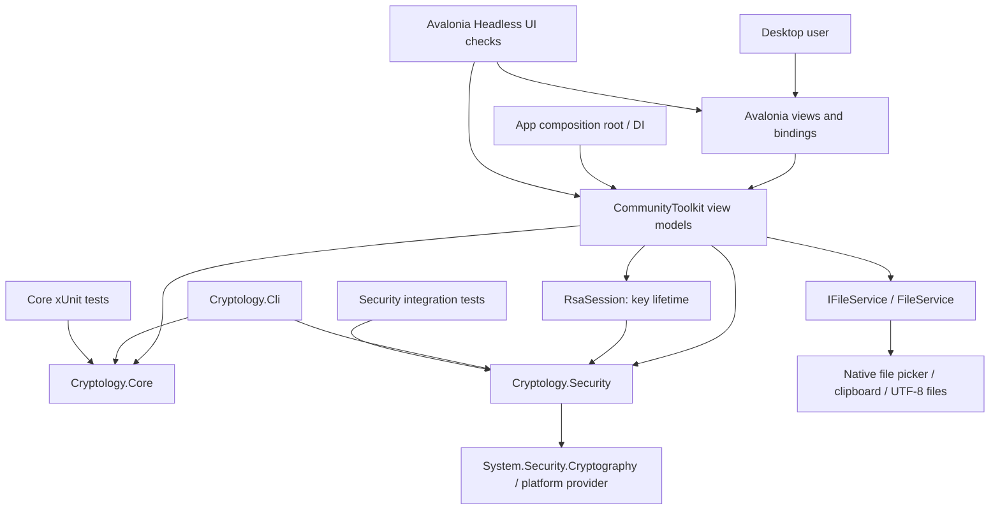

# Architecture

The solution separates mathematical behavior from presentation and OS integration. Core has no Avalonia, filesystem dialog, clipboard or security-provider dependency. Security is a separate library because a textbook BigInteger RSA demonstration and a platform-backed RSA scheme have different guarantees and key lifetimes.

Arrows mean a runtime dependency or a test target. Security does not depend on Core, and neither library depends on Desktop. Original Python files are historical inputs for audit/reference-vector tools, not runtime dependencies.

## Core

- `Models.Alphabet` centralizes exact EN/UA membership and case-preserving alphabet operations.
- `ClassicalCiphers` validates complete substitution permutations and Vigenère keys and preserves nonalphabet text.
- `Cryptanalysis` provides frequency rows, n-grams, transparent initial guesses, Caesar scores and partial-map preview/statistics.
- `NumberTheory` owns GCD/Bézout, inverse, square-and-multiply, CSPRNG sampling, Jacobi and probable-prime tests. It uses `BigInteger` and checks `CancellationToken` within long loops. Optional traces are capped independently of computation.
- `Asymmetric.EducationalRsa` exposes integer textbook equations and an immutable educational key; raw SHA-256 representative signing is explicitly insecure.
- `SecretSharing` evaluates prime-field polynomials, carries threshold metadata through strict JSON, validates points and reconstructs with Lagrange interpolation. It provides no authenticity.

## Security

`ByteOneTimePad` defines XOR on strict UTF-8 bytes, exact pad length and encodings. It clears temporary byte arrays but cannot erase all UI strings or enforce one-use-pad handling.

`ModernRsaService` owns an `RSA` provider instance, OAEP-SHA256, PSS-SHA256, streaming file hashing and constrained PEM exchange. Provider padding is never reimplemented in Core. Public-only sessions cannot sign/decrypt; encrypted private export needs explicit consent. See [security.md](../security.md) for the complete boundary.

## Desktop and MVVM

`App` is a small dependency-injection composition root. It creates the localization service, filesystem/clipboard service, RSA session and shell. `ShellViewModel` retains ten module view models so navigation does not recreate algorithm state.

Avalonia views bind to observable properties and generated asynchronous commands from CommunityToolkit.Mvvm. Small code-defined view factories compose module controls; their event handling is limited to presentation, while transformations and validation remain in the libraries/view models. This is a deliberate compact MVVM implementation, without a separate class for every label or button.

UI language lives in `Resources.Strings`; algorithm alphabet is a module-level setting. Theme changes use Avalonia theme variants and dynamic resources. The technical interface uses a minimum window size and scrolling to keep inputs/results usable.

Long computations run on worker tasks, results are applied through the view-model command flow, and cancellation propagates into Core or streaming hash operations. Cryptanalysis previews debounce text/mapping edits and cancel stale work. Platform RSA operations are synchronous provider calls after cancellable preparation; an in-progress provider call is not interruptible.

`FileService` uses Avalonia's native storage picker, strict UTF-8, an editor import limit of 32 MiB and clipboard APIs. File signing selects a local path and streams arbitrary file bytes through the Security library. Text import limits do not define signature-file limits.

## Verification and evolution

Core tests focus on mathematical controls, invariants, invalid domains and round trips. Security tests exercise provider interoperation, byte/format limits, tamper rejection, wrong keys and cancellation. UI checks execute the headless Avalonia backend; native checks are separately recorded in [validation.md](../validation.md).

The [migration map](../audit/README.md) connects each of the thirteen original modules to its new home and explains intentional behavior changes. Static pure APIs and a small DI boundary keep this project understandable for a developer demonstrating both algorithms and desktop engineering.
